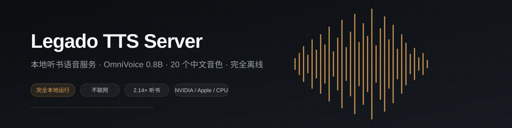
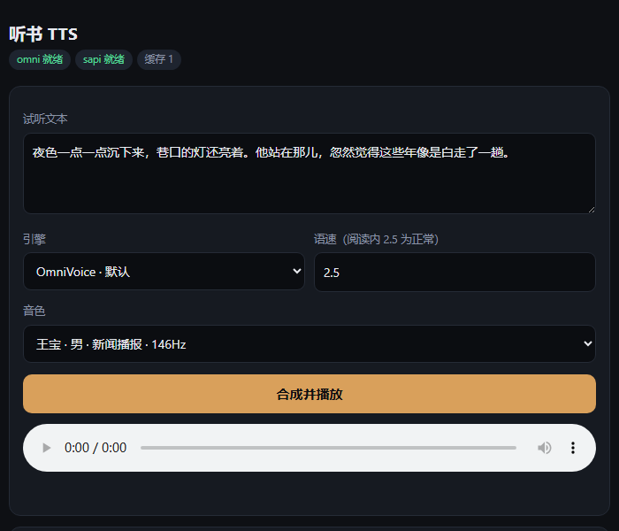

<div align="center">



# Legado TTS Server

by [baifagg](https://github.com/baifagg)

[简体中文](README.md) · [English](README.en.md)

</div>

---

A Chinese text-to-speech service that runs on your own computer. A reading app on your phone connects over Wi-Fi and streams the audio. The model is OmniVoice 0.8B with 20 Chinese voices, about a second per sentence.

## Easiest path: hand the repo to an AI agent

You don't have to work through the commands yourself. Copy this line, together with the repo URL, into any assistant that can run shell commands — Claude Code, ChatGPT, DeepSeek, Codex, Cursor all work:

> Set this project up for me, then give me the import link for my phone: https://github.com/baifagg/legado-tts-server

It will check your GPU, install the matching PyTorch build, download the model, start the service, and hand you the import link.

If something fails, paste the error back and let it keep fixing. That's what [AGENTS.md](AGENTS.md) is for: step-by-step commands, the expected output at each step, and a fault tree for the common failures. The agent reads it so you don't have to.

Once it's running, voice selection, port changes and log reading can all go to the agent too.

## If you'd rather do it yourself

Python 3.10 to 3.12.

```bash
git clone https://github.com/baifagg/legado-tts-server
cd legado-tts-server
python install.py
```

The script checks your GPU, installs the matching PyTorch build, then downloads the model (about 3 GB). Add `--mirror` if you're in mainland China.

Then run the check:

```bash
python doctor.py
```

Fix anything marked red before moving on. Run it again whenever something breaks; the output usually says what to do.

On the GPU side: NVIDIA with 6 GB or more VRAM works best. Apple Silicon runs on MPS. AMD works through ROCm on Linux only; on Windows it falls back to CPU. CPU-only is usable but slow, five to fifteen seconds per sentence. Per-model details in [docs/GPU-COMPATIBILITY.md](docs/GPU-COMPATIBILITY.md).

## Connecting your reading app

```bash
python run.py
```

The terminal prints two import links. Put the phone on the same Wi-Fi, open the reading app's reading-engine settings, choose network import, paste a link.

- Link A: `http://<your-ip>:18760/httpTTS-float.json`, speed scale 0–2.0
- Link B: `http://<your-ip>:18760/httpTTS.json`, speed scale 1–100

Most recent builds of Legado use A. **开源轻页 also uses A, not B.**

One import gives you 20 voices, switchable in the reading-engine list. Ten male and ten female, including middle-aged, elderly and storyteller voices. Genre suggestions are in [docs/VOICES.md](docs/VOICES.md).

Changing ports or forcing CPU:

```bash
python run.py --port 18860
python run.py --device cpu
```

Open `http://127.0.0.1:18760/` in a browser to audition each voice before picking one:



API parameters and error codes are in [docs/API.md](docs/API.md); longer troubleshooting notes are in [docs/TROUBLESHOOTING.md](docs/TROUBLESHOOTING.md).

## Reading apps that pair with it

[Legado (阅读)](https://github.com/gedoor/legado) is the original implementation of the protocol, a long-standing Android reader. This service started as a way to listen to books in it.

[开源轻页 / qingye-reader](https://github.com/wip3l/qingye-reader) is a native HarmonyOS NEXT reading app written in ArkTS and ArkUI. It's compatible with Legado book sources and handles local TXT, EPUB, MOBI, PDF, plus OPDS and WebDAV. It has built-in TTS and uses link A with this server.

Other readers work too if they implement Legado's reading-engine protocol. Try it and see: after importing, play a passage with numbers, and if you hear "百分之十五" rather than "十五", it's wired up correctly.

## Credits

Model by [k2-fsa/OmniVoice](https://github.com/k2-fsa/OmniVoice). Reference voices come from [AISHELL-3](https://www.openslr.org/93/). The protocol follows [gedoor/legado](https://github.com/gedoor/legado).
