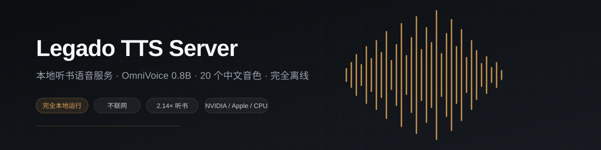
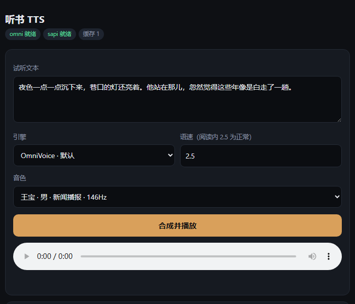

<div align="center">



# Legado TTS Server

by [baifagg](https://github.com/baifagg)

[简体中文](README.md) · [English](README.en.md)

</div>

---

电脑上跑一个中文语音合成服务，手机上的阅读软件连过来听书。模型是 OmniVoice 0.8B，带 20 个中文音色，一句大概一秒多。

## 最省事的办法：把仓库丢给 AI

不用自己啃命令。复制下面这句话，连同仓库地址，发给任意一个能执行命令的助手（Claude Code、ChatGPT、DeepSeek、Codex、Cursor 都可以）：

> 帮我部署这个项目，装好后把手机端的导入链接发给我：https://github.com/baifagg/legado-tts-server

它会自己判断你的显卡、装对应版本的 PyTorch、下载模型、启动服务，最后把导入链接给你。

中途报错也不用自己研究，把报错原文粘回去让它接着修就行。仓库里的 [AGENTS.md](AGENTS.md) 就是为这种情况写的：分步命令、每一步的预期输出、常见故障的排查路径都在里面。agent 读了就知道怎么处理，你不用读。

装完之后想调音色、换端口、看日志，照样问它。

## 想自己装的话

要 Python 3.10 到 3.12。

```bash
git clone https://github.com/baifagg/legado-tts-server
cd legado-tts-server
python install.py
```

脚本会先看显卡，装对应版本的 PyTorch，然后下模型（3 GB 左右）。国内网络加 `--mirror`。

装完自检一遍：

```bash
python doctor.py
```

有红色项按提示修，全过了再往下。以后哪一步出问题也先跑它，输出里一般直接写了怎么修。

显卡这块，NVIDIA 6 GB 显存以上最顺。Apple Silicon 走 MPS 也可以。AMD 在 Linux 上能折腾 ROCm，Windows 上只能跑 CPU。没有独显也能用，一句五到十几秒，试听可以，长时间听不划算。型号对照在 [docs/GPU-COMPATIBILITY.md](docs/GPU-COMPATIBILITY.md)。

## 接到阅读软件里

```bash
python run.py
```

终端会打印两个导入链接。手机和电脑连同一个 WiFi，在阅读软件的朗读引擎里选网络导入，粘进去。

- 链接 A：`http://<电脑IP>:18760/httpTTS-float.json`，语速 0~2.0 刻度
- 链接 B：`http://<电脑IP>:18760/httpTTS.json`，语速 1~100 刻度

大多数新版阅读用 A。**开源轻页也用 A，不要选 B。**

导入一次拿到 20 个音色，在朗读引擎列表里换着听。男声女声各 10 个，有中年、老年和评书，按题材挑，对照表在 [docs/VOICES.md](docs/VOICES.md)。

换端口或者强制用 CPU：

```bash
python run.py --port 18860
python run.py --device cpu
```

浏览器打开 `http://127.0.0.1:18760/` 是试听页面，可以先听听音色再决定用哪个：



接口参数和报错码在 [docs/API.md](docs/API.md)，更细的排障在 [docs/TROUBLESHOOTING.md](docs/TROUBLESHOOTING.md)。

## 配套的阅读软件

[阅读 / Legado](https://github.com/gedoor/legado) 是这套协议的原版实现，安卓上的老牌阅读器。这个服务最早就是给自己用 Legado 听书写的。

[开源轻页 / qingye-reader](https://github.com/wip3l/qingye-reader) 是鸿蒙 NEXT 上的原生阅读应用，ArkTS 和 ArkUI 写的，兼容 Legado 书源，支持本地 TXT、EPUB、MOBI、PDF 和 OPDS、WebDAV。它自带朗读，接本服务时同样用链接 A。

这两个之外的阅读软件，只要支持 Legado 的朗读引擎协议就能用，自己试一下。判断办法：导入后找一段带数字的正文，听到「百分之十五」而不是「十五」，就说明接对了。

## 致谢

模型是 [k2-fsa/OmniVoice](https://github.com/k2-fsa/OmniVoice)，参考音色取自 [AISHELL-3](https://www.openslr.org/93/) 语料，协议对标 [gedoor/legado](https://github.com/gedoor/legado)。
